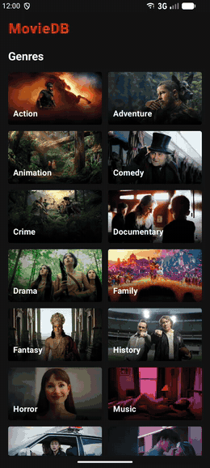
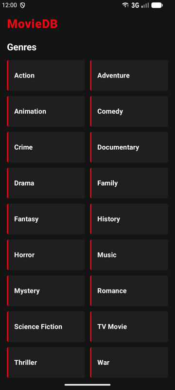
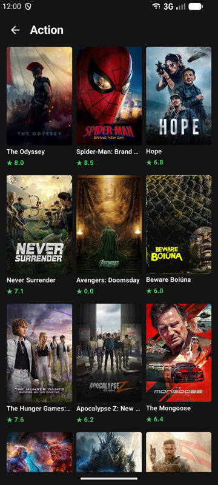
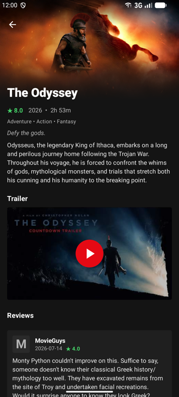
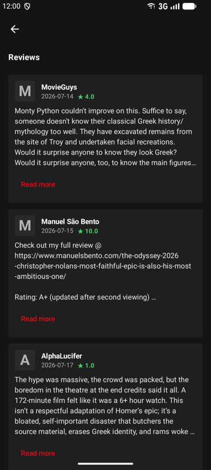
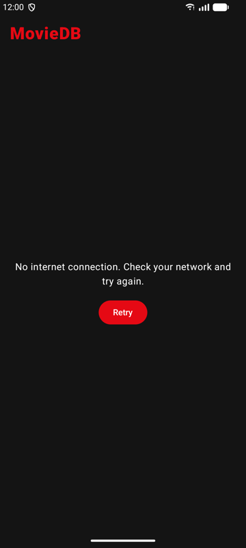

# MovieDB

Native Android app that browses movies from the [TMDB API](https://developer.themoviedb.org), with a dark, Netflix-inspired look.

## Demo

<p align="center">
  
</p>

## Screenshots

| Genres | Movies by genre | Movie detail |
|:---:|:---:|:---:|
|  |  |  |
| **User reviews** | **Error state (offline)** | |
|  |  | |

## Features

1. **Genres** – official list of movie genres.
2. **Movies by genre** – discover movies for the selected genre, with endless scrolling.
3. **Movie detail** – poster/backdrop, title, tagline, rating, year, runtime, genres and overview.
4. **User reviews** – paged list of reviews with "Read more" for long texts, with endless scrolling.
5. **Trailer** – the YouTube trailer plays in-app; if the player cannot load, an "Open on YouTube" button is shown.
6. **Positive and negative cases** – loading, empty and error states (no network, timeout, HTTP 401/404/5xx) with a Retry action; a failed next page keeps the loaded items and shows an inline retry row.
7. **Netflix-inspired UI** – always-dark theme with red accents, 3-column poster grid, full-width backdrop with gradient on the detail screen.

## Tech stack

Kotlin 2.0.21 · Jetpack Compose + Material 3 · MVVM + Repository (Clean Architecture) · Hilt · Retrofit + Moshi + OkHttp · Paging 3 · Coil · Navigation Compose · android-youtube-player 13.1.0.

## Architecture

```
app/                 MainActivity, Hilt application, navigation graph
core/domain/         models, MovieRepository interface, AppError, Resource
core/data/           MovieRepositoryImpl, PagingSources, DTO → domain mappers, error mapping (data layer)
core/network/        TmdbApi (Retrofit), DTOs, OkHttp/Moshi setup (remote data source)
core/ui/             theme + reusable composables (loading, error + retry, empty, paging footer, poster, rating)
feature/genres/      GenreScreen + GenreViewModel
feature/movies/      MovieListScreen + MovieListViewModel (Paging 3)
feature/detail/      MovieDetailScreen + MovieDetailViewModel, trailer player, reviews list
```

Flow: `Screen (Compose) → ViewModel (StateFlow / Flow<PagingData>) → MovieRepository (core/domain) → MovieRepositoryImpl (core/data) → TmdbApi (core/network)`.
Errors are mapped once, in `core/data`, to a sealed `AppError` and shown as readable messages in the UI.

The data layer is a separate module so a local source (e.g. Room as the single source of truth with a Paging `RemoteMediator`) can be added in `core/data` later without changing the feature modules.

## Setup

1. Create a TMDB **API Read Access Token** at https://www.themoviedb.org/settings/api.
2. Add it to `local.properties` (git-ignored):
   ```properties
   TMDB_ACCESS_TOKEN=your_read_access_token
   ```
3. Open the project in Android Studio (JDK 17) and run the `app` configuration, or:
   ```bash
   ./gradlew installDebug
   ```

Requirements: Android Studio with Android SDK 35, min SDK 24.

## Tests

```bash
./gradlew testDebugUnitTest            # unit tests (mappers, error mapping, paging, repository, ViewModels)
./gradlew connectedDebugAndroidTest    # UI tests (needs a device/emulator)
```

Unit tests cover the positive and negative paths: success, empty list, no network, timeout, HTTP 401/404/5xx,
null fields, last page, a failing second page, and a movie without a YouTube trailer.
UI tests cover the error → retry → content flow, the poster grid, the detail screen, double-tap on Back,
and the shared components (theme colours, poster placeholder, rating format in any locale, grid paging footer).

Movie data is provided by [TMDB](https://www.themoviedb.org). This product uses the TMDB API but is not endorsed or certified by TMDB.
